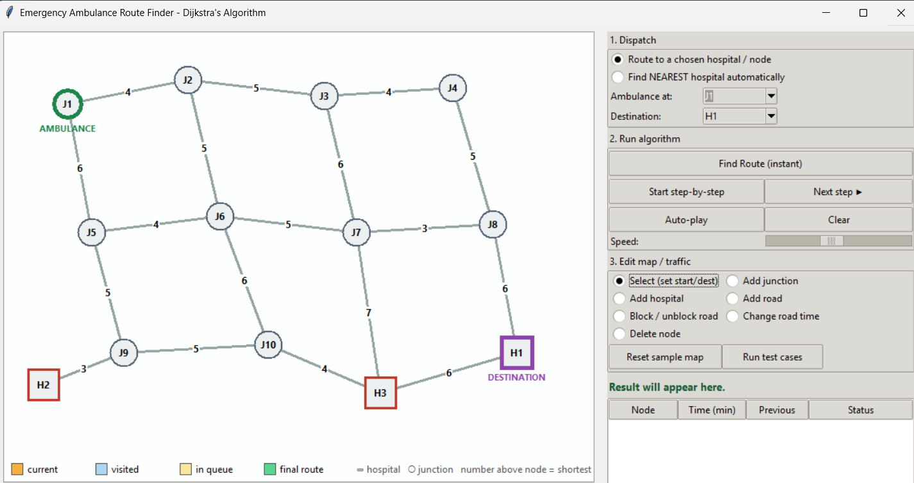

# Emergency Ambulance Route Finder Using Dijkstra's Algorithm

An interactive graphical application designed to find the shortest and fastest emergency route using **Dijkstra’s Shortest Path Algorithm**. Built with map-editing tools, step-by-step visual traversal, and priority queue analytics.

---

## Application Screenshot

---
What the app does
Problem: the city is a graph. Junctions and hospitals are vertices, roads are edges, and each edge weight is the travel time in minutes. The app finds the fastest route for an ambulance, either to a hospital you choose or to the nearest hospital automatically.
Inputs: left-click a node to set the ambulance start and right-click a node to set the destination. You can also add junctions, hospitals and roads, edit a road’s travel time to model traffic, block a road for an accident or flood, and delete nodes.
Visualization:
Colours show current, visited, in-queue and final-route nodes.
The number above each node is its shortest time so far.
A live table shows time and previous node, and a step log explains each relax or check.
Use “Find Route” for an instant answer, or “Start step-by-step”, “Next step” and “Auto-play” with a speed slider to watch the algorithm run.
Early stop: the search stops when the first hospital is extracted from the priority queue, because that distance is already final.

## Key Features

* **Interactive Map Editor:** Add/delete junctions and hospitals, create or block roads, and modify transit times dynamically.
* **Smart Dispatch Panel:** Choose custom ambulance start locations and destination hospitals or find the nearest hospital automatically.
* **Step-by-Step Traversal Visualizer:** Watch Dijkstra's algorithm explore nodes using a priority queue with adjustable animation speed.
* **Live Distance & Path Table:** Real-time logging of visited nodes, shortest time metrics, and predecessor pointers.
* **Built-in Test Suite:** Automated test cases to verify algorithm correctness under various traffic and roadblock conditions.

---

## Complexity Analysis

* **Time Complexity:** $O((V + E) \log V)$ 
  * *Where $V$ is the number of road junctions/hospitals (vertices) and $E$ is the connecting roads (edges).* Utilizing a min-priority queue ensures efficient edge relaxation.
* **Space Complexity:** $O(V + E)$ 
  * *Required for storing the graph adjacency list, distance/cost tracking tables, priority queue, and parent pointers for final path reconstruction.*

---

## How to Run Locally

1. Clone or download this repository to your local machine.
2. Run the application script in your Python environment (or open the relevant execution file).
3. Interact with the GUI to dispatch ambulances and test routes!

